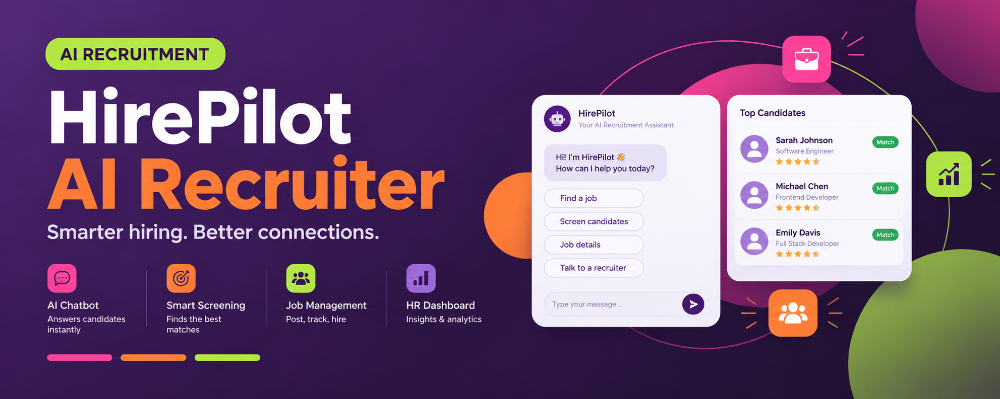
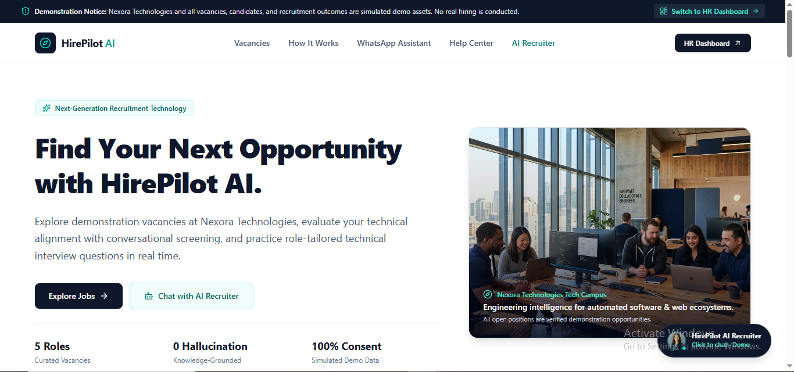
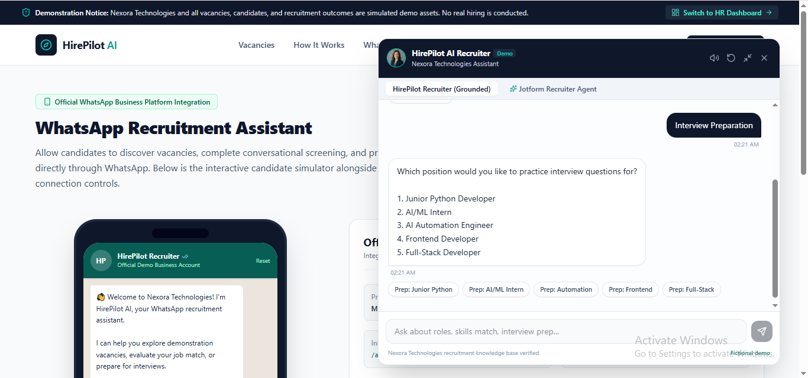
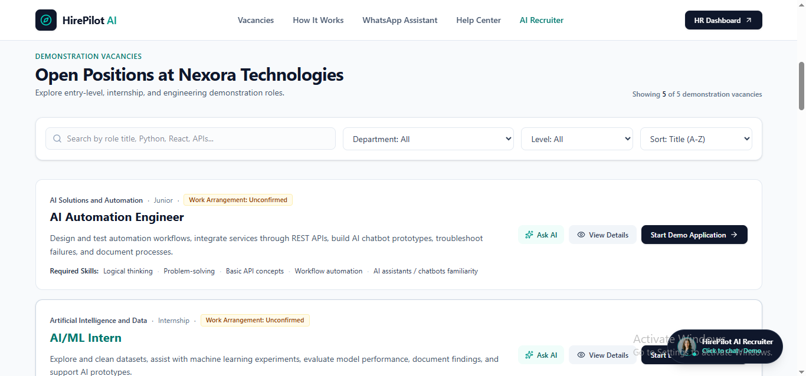
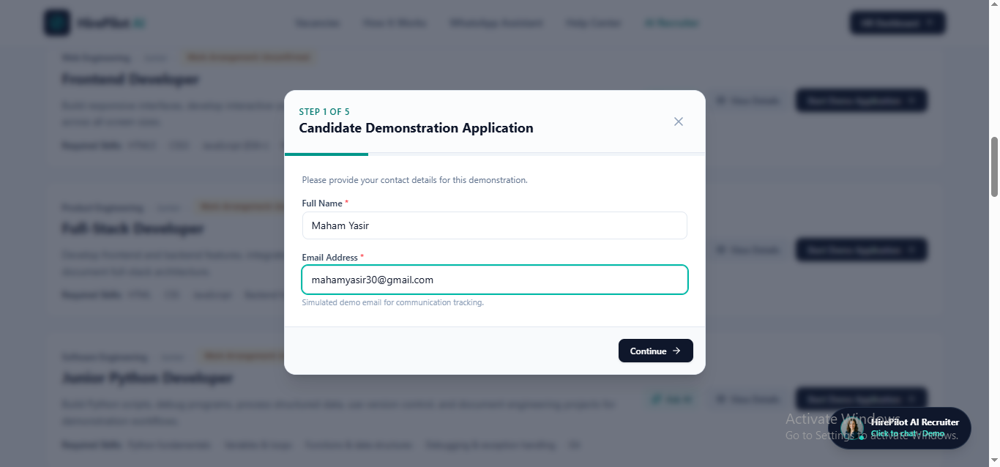
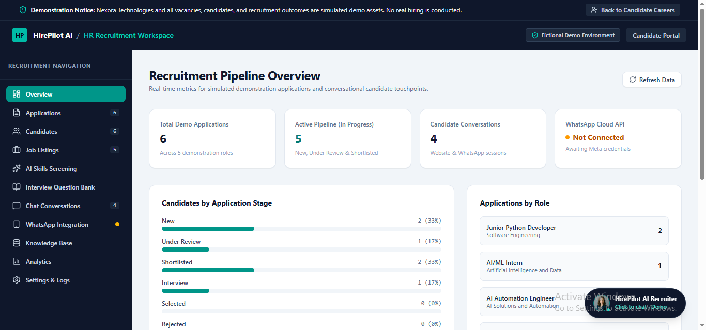
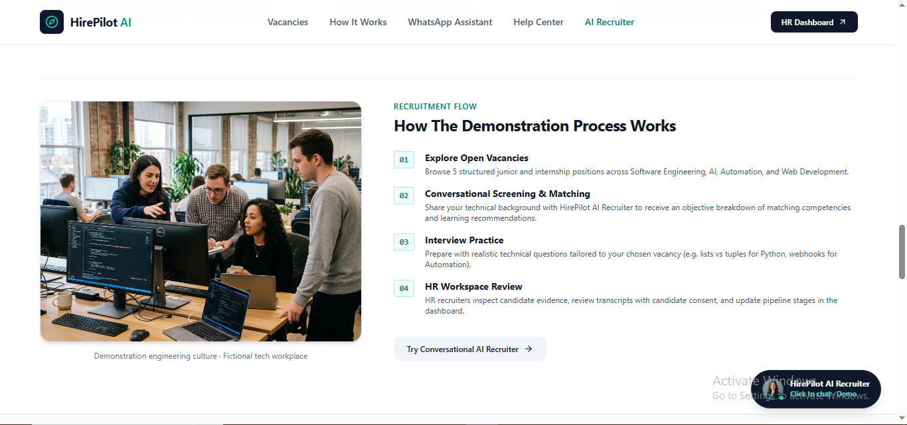

 
<div align="center">
  
</div>

<h1 align="center">HirePilot AI Recruiter</h1>

<p align="center">
  <strong>Smarter hiring. Better connections.</strong>
  <br>
  An AI-focused recruitment web application exploring more accessible and efficient hiring workflows.
</p>

<p align="center">
  <a href="https://hire-pilot-ai-recruiter.vercel.app/"><strong>🚀 Live Demo</strong></a>
  &nbsp; · &nbsp;
  <a href="https://github.com/MahamYasir-ai/HirePilot-AI-Recruiter">Source Code</a>
</p>

<p align="center">
  
  
  
</p>

---

## Overview

HirePilot AI Recruiter is a recruitment-focused web application built to explore how AI-powered interfaces can support hiring workflows.

The project brings recruitment-related interactions into a modern web experience, with an emphasis on usability, organized information, and practical AI application development.

## Features

- **AI Recruitment Chatbot** — a conversational interface for recruitment-related interactions.
- **Job Listings** — a place to explore job-related information.
- **Candidate Applications** — supports the candidate application workflow where implemented.
- **Recruitment Dashboard** — a centralized interface for recruitment-related information.
- **Candidate Screening** — explores ways AI can assist with reviewing candidate information.
- **Modern Web Interface** — a user-focused application experience.
- **Deployment** — publicly accessible demo hosted on Vercel.

*The availability of individual features depends on the current application implementation.*

## Application Preview

### 1. Home Page



### 2. AI Recruitment Chatbot



### 3. Job Listings



### 4. Candidate Application



### 5. HR Dashboard



### 6. AI Candidate Screening



## Technology Stack

The project repository includes a modern web application structure using:

- TypeScript
- React-based frontend
- Vite
- Node.js
- Vercel deployment

See the source code and `package.json` for the exact dependencies and configuration.

## Run Locally

### Prerequisites

- Node.js and npm
- Git

### Installation

Clone the repository:

```bash
git clone https://github.com/MahamYasir-ai/HirePilot-AI-Recruiter.git
cd HirePilot-AI-Recruiter
```

Install dependencies:

```bash
npm install
```

Start the development server using the script configured in `package.json`. For a typical Vite application:

```bash
npm run dev
```

If the command differs, check the available scripts in `package.json`. Configure any required environment variables according to the project's implementation.

## Project Goals

This project is part of my practical journey into AI engineering and application development. It explores the intersection of conversational AI, recruitment workflows, and web interfaces while strengthening skills in building and presenting usable AI-powered applications.

## Potential Improvements

- Refine recruitment chatbot interactions.
- Improve candidate review and screening workflows.
- Enhance dashboard usability and information presentation.
- Add robust input validation and error handling.
- Document API integrations and environment variables.
- Expand testing and deployment documentation.

## Author

**Maham Yasir**

Electronics Engineering graduate exploring AI engineering, machine learning, automation, and web application development.

- GitHub: [@MahamYasir-ai](https://github.com/MahamYasir-ai)

---

<p align="center">
  <sub>Building practical projects at the intersection of AI and software development.</sub>
</p>
